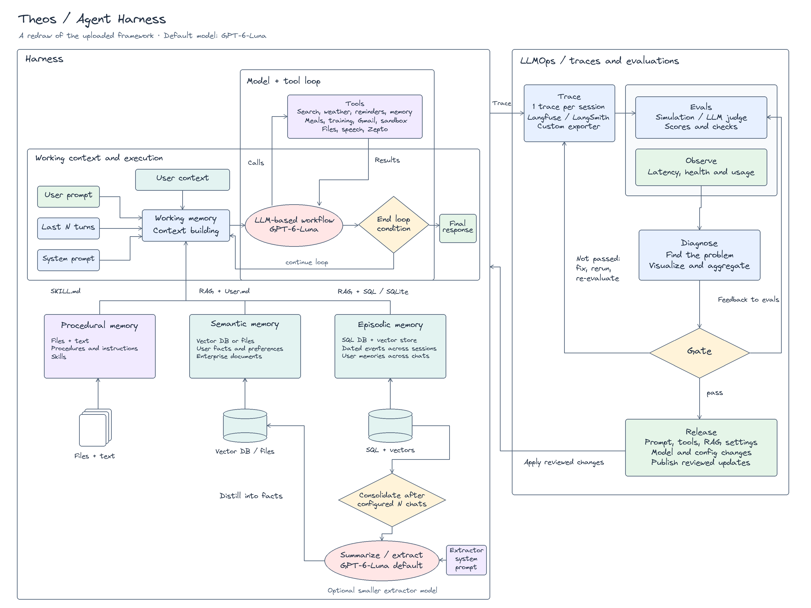
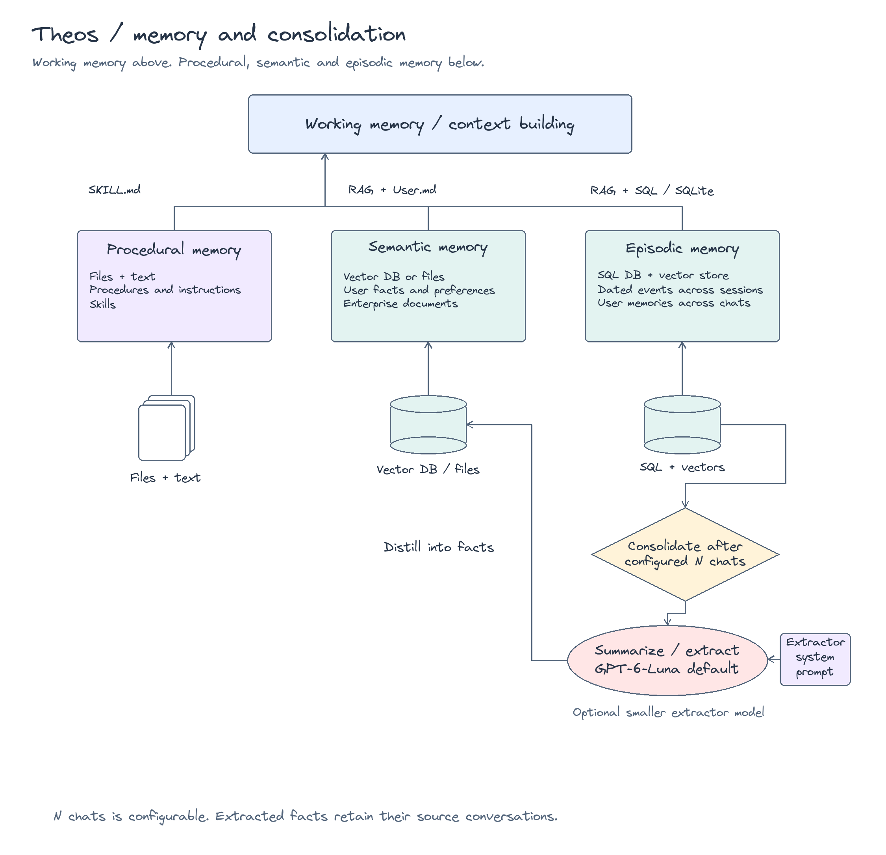

# Architecture diagram library

Read the [architecture guide](../architecture.md) for the framework, its implementation mapping, and all six diagrams.

The complete framework is the primary architecture view.
It preserves the uploaded Agent Harness framework.
It preserves the harness boundary, model and tool loop, memory stores, consolidation flow, and LLMOps feedback paths.
The Excalidraw MCP rendered every diagram below.
All diagram text uses Excalidraw's traditional handwriting font.

| Diagram | Editable source | Preview | MCP checkpoint |
| --- | --- | --- | --- |
| Complete framework | [Excalidraw](theos-framework.excalidraw) | [PNG](theos-framework.png) / [SVG](theos-framework.svg) | `65e828e5fad447d7b8` |
| Memory and consolidation | [Excalidraw](theos-memory.excalidraw) | [PNG](theos-memory.png) / [SVG](theos-memory.svg) | `9c3e1b00bc29483aa9` |
| LLMOps feedback loop | [Excalidraw](theos-operations.excalidraw) | [PNG](theos-operations.png) / [SVG](theos-operations.svg) | `ba1a8336d42744aa9a` |
| Planned tools | [Excalidraw](theos-tools.excalidraw) | [PNG](theos-tools.png) / [SVG](theos-tools.svg) | `e30817048481493188` |
| Current service boundaries | [Excalidraw](theos-services.excalidraw) | [PNG](theos-services.png) / [SVG](theos-services.svg) | `66eb68d358104b6cac` |
| Telegram sequence | [Excalidraw](theos-telegram.excalidraw) | [PNG](theos-telegram.png) / [SVG](theos-telegram.svg) | `0ac33544769e4bf2b2` |

## Complete framework



This is the primary view in the README, documentation home, and architecture guide.
It covers the harness, memory paths, consolidation, and operations feedback.

## Memory and consolidation



Automatic extraction and consolidation remain future work.
The [memory guide](../memory.md) describes the current explicit service tools.

## LLMOps feedback loop


LLMOps means large language model operations.
The evaluation and release feedback paths remain planned components.
Read [observability](../base-infra/observability.md) for current logs, traces, and usage records.

## Framework tool design

This preserved design map predates the current tool catalog.
Some callable names differ from the implemented names.
The tool map names the callables for search, weather, reminders, meals, training, memory, custom tables, and sandbox work.
It also includes durable files, skills, browser automation, speech, Google Health, Gmail, and Zepto shopping.
Read the [tool catalog](../tool-catalog.md) for exact behavior, dependencies, and delivery phases.
Remote MCP schemas need authenticated discovery before registration.


## Current service boundaries


This runtime diagram maps the framework to implemented services and code directories.
Use the [tool catalog](../tool-catalog.md) for current callable names.
The architecture guide places this view under [Current implementation](../architecture.md#current-implementation).
The [code guide](../code-structure.md) uses it as the main navigation view.

## Telegram integration

Telegram is an application extension to the uploaded framework.
The sequence view shows its relationship to the runtime, harness, and SQLite.


## Source and font

The [original upload](reference/Agent-Harness.excalidraw) remains unchanged.
Its source path is `/Users/nightowl/Downloads/Agent-Harness.excalidraw`.
The redraw retains the original spatial structure and uses clearer connector routes.
The planned consolidation design uses GPT-6-Luna, with an optional smaller extractor model.
The application does not implement that consolidation path.

The traditional handwriting font uses Excalidraw font family `1`.
The local previews use the same bundled font.
The bundled [font license](fonts/LICENSE.md) is the SIL Open Font License.

These diagrams describe the architecture. They do not claim that every component is implemented.
Read the [code guide](../code-structure.md) and [acceptance checks](../runtime/acceptance.md) for implementation status.

## Maintain the redraw

Install the preview dependency:

```sh
uv sync --group design
```

Regenerate the editable sources and previews:

```sh
uv run python scripts/render_architecture.py
uv run python scripts/render_service_map.py
```

Render each updated `.elements.json` file through the Excalidraw MCP.
Record its checkpoint here.
The native files and MCP inputs contain the same elements and font selection.
