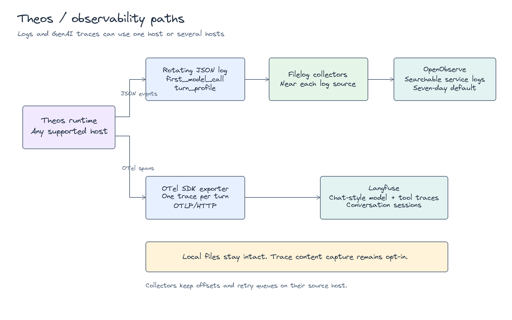
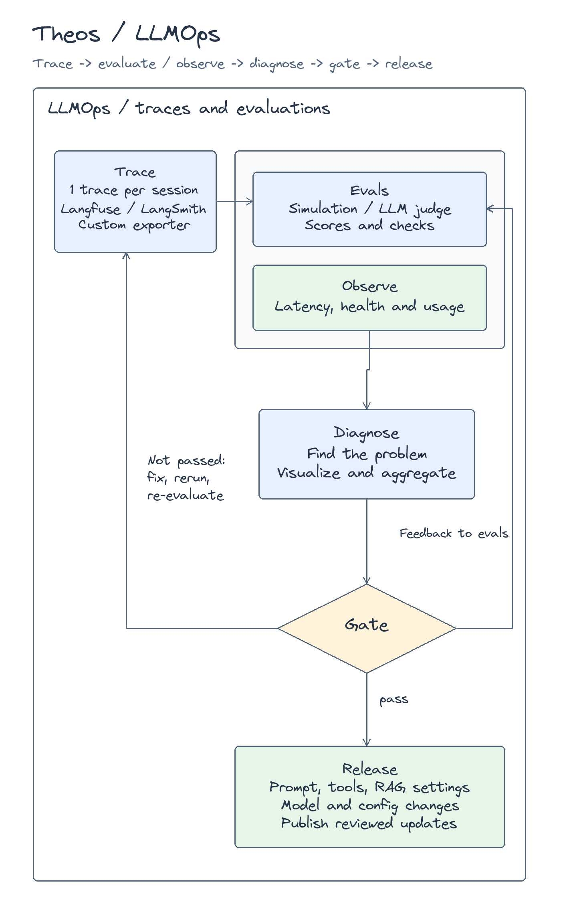
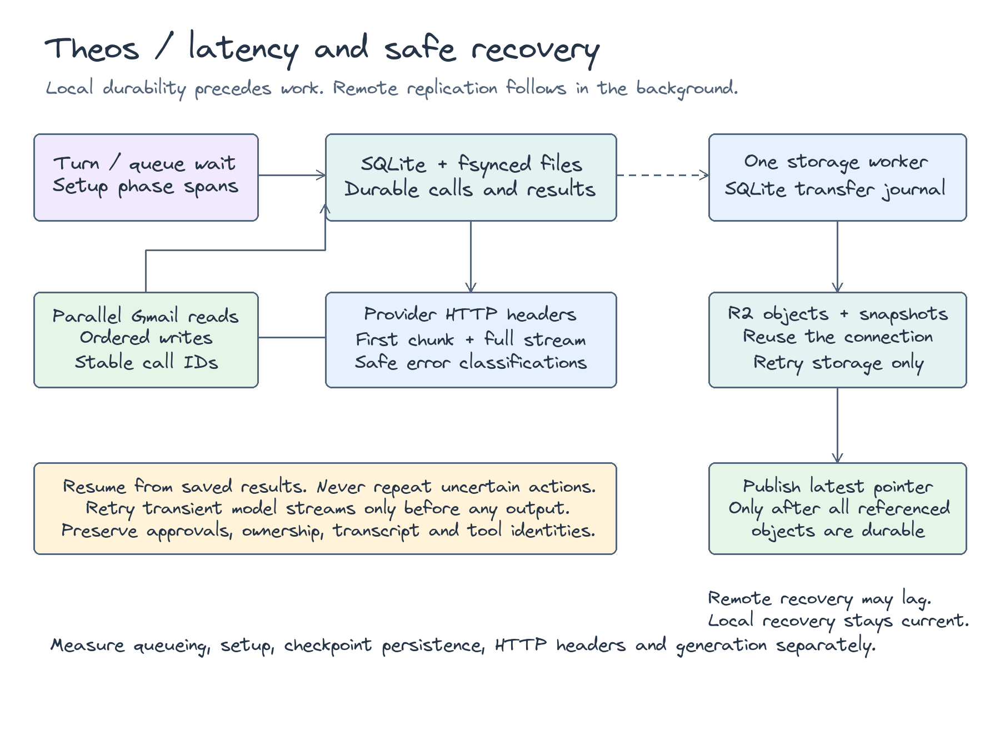

# Observability

Theos records application events, tool traces, and model usage locally.
Optional OpenTelemetry tracing exports one trace per turn through OTLP/HTTP protobuf.

OpenRouter can reject saved encrypted reasoning when its required endpoint conflicts with zero data retention.
The adapter retries that routing rejection once without the affected reasoning sequences, before generation starts.
It preserves ZDR, visible history, tool exchanges, and request options.
The log event `openrouter_reasoning_replay_rejected` records this recovery without private content.
For OpenAI models, each request replays only the latest known provider format of encrypted reasoning.
The adapter omits incompatible sequences from the wire request and retains saved messages and signed blocks.
It also retries a mixed-provider HTTP 400 once before generation, without incompatible reasoning.
The event `turn_incomplete` records a turn that needs finalization.
The call budget counts harness model calls. SDK retries and this bounded routing retry are transport attempts within those calls.
The application log formatter excludes prompts, credentials, and remote error bodies.
Conversation history remains private data in SQLite and needs separate protection.

Model spans also record the actual output allowance and explicit reasoning effort, or `provider_default` when omitted.
They record serialized request bytes, input message count, tool schema count, and validated routing controls.
These fields exclude prompt text, tool schemas, credentials, and arbitrary request options.
OpenRouter reasoning-token usage appears as `gen_ai.usage.reasoning.output_tokens` when reported.
Reasoning tokens are part of total output tokens. They are not billed or counted again.

## Outputs

| Output | Location | Contents |
| --- | --- | --- |
| Application events | `AGENT_DATA_DIR/logs/theos.log` | Fixed event names, timestamps, levels, safe metadata, and per-turn timing profiles |
| Runtime traces | `traces` table in `theos.sqlite3` | Owner, session, event, tool name, status, and timestamp |
| OpenTelemetry spans | Configured OTLP endpoint | Turn, model, tool, delegate, and title timing with token counts and status |
| Model usage | `usage` table in `theos.sqlite3` | Owner, session, model, token counts, and optional cost estimate |
| Conversation state | `sessions` and related SQLite tables | Messages, tool arguments, results, and approval state |
| Container output | Docker logging driver | Process and HTTP server output |

Compose stores application data under `/data`.
Application events use a file handler and do not propagate to container output.
The server suppresses verbose harness and external client loggers.

## Read application events

```sh
docker compose exec -T theos tail -n 100 /data/logs/theos.log
docker compose exec -T theos tail -F /data/logs/theos.log
```

The first command reads recent JSON lines; the second follows new events across file rotation. For a native process, read `$AGENT_DATA_DIR/logs/theos.log` (the standalone terminal defaults to `~/.theos/logs/theos.log`). `docker compose logs --tail=100 -f theos` reads container process output, which is separate from these application events. The browser admin token can also call `GET /api/logs` for up to 100 recent events; the **Admin dashboard** displays this feed.

| Event | Meaning |
| --- | --- |
| `started` | Application workers entered their lifespan |
| `first_model_call` | Seconds from turn start until the first model request, including harness waits and preparation |
| `turn_profile` | One safe timing profile per reserved turn, including failures and cancellations |
| `response_delivery` | Time from the final event entering the queue until the transport consumer finishes or closes |
| `turn_incomplete` | A turn reached a limit or raised an exception before its final answer |
| `delegate_incomplete` | One delegate stopped and returned available findings |
| `final_answer_unavailable` | The bounded final request failed, so the runtime returned saved findings |
| `integration_unavailable` | Optional integration discovery failed |
| `telegram_update_failed` | An accepted Telegram update failed |
| `notification_failed` | Reminder delivery failed or has an uncertain outcome |
| `scheduler_failed` | Scheduled work raised an exception |
| `trace_export_failed` | Remote trace delivery failed |

The formatter retains every fixed Theos event name and permits only known fields. `turn_profile` contains request acceptance, concurrency wait, history restore, input save, model setup, capacity lookup, tool registration, memory retrieval, prompt assembly, harness work, recovery, finalization, and total duration when each stage ran. It also contains model and tool counts, up to 64 individual model timings, model first-event wait, total model time, total tool time, and a bounded per-tool-name summary. `request_accept_seconds` begins at HTTP ingress, Telegram update processing, local terminal input, or scheduled task dispatch and ends when the runtime reserves the turn. `time_to_first_model_call_seconds` begins at reservation and ends when the harness yields its first parent model request. `model_wait_seconds` runs from each model call to its first streamed event or complete response; it includes provider/network wait and is not a separate provider queue measurement. Prompt assembly time excludes the separately reported memory retrieval time. Concurrent model and tool totals can exceed wall-clock time. `response_delivery` measures application-side consumer drain after the runtime queues `done`; it does not prove that a remote browser or Telegram client displayed the result.

The formatter permits `error_type`, `session_id`, and bounded numeric timing fields.
It does not include exception text or stack traces.
A generic error type can require a separate service check.

## Private dashboard

1. Configure a browser token in `AGENT_USERS`.
2. Add that user ID to `AGENT_ADMINS`.
3. Sign in through the browser page.
4. Open **Admin dashboard**.

`GET /api/dashboard` requires an administrator token.
It returns users, recent sessions, usage totals, recent traces, recent jobs, and the last scheduler tick.
`GET /api/logs` returns up to 100 recent application events.
There is no separate `/dashboard` page.

## View traces in Langfuse

Langfuse is the primary viewer for model and tool traces. Theos exports standard OTLP/HTTP protobuf and adds Langfuse attributes for observation type, captured input/output, and the conversation session.
The existing `gen_ai.*` attributes remain on the spans, so the same trace data can also go to another OTel backend.
Content capture stays disabled unless `AGENT_TRACING__CAPTURE_CONTENT=true`. When enabled, bounded messages and tool data are sent to the trace backend.

The Mac mini runs Langfuse `v4.80.0` with persistent Docker volumes. The private UI uses Tailscale Serve on port `8445`.
The local development helper runs a separate stack on this Mac:

```sh
python3 scripts/deploy_langfuse_local.py
```

The local helper stores credentials under `.theos/langfuse-local/`.
Use `--port 3001 --public-url http://localhost:3001` if port 3000 is already in use.
The Mac mini login details stay in `~/.local/share/theos-observability/.theos/langfuse-local/access.txt`.
Open [Langfuse](https://parths-mac-mini.tail61f0ca.ts.net:8445) while connected to Tailscale.

Send a disposable fake-model turn to check trace ingestion without an OpenAI request or production conversation data:

```sh
uv run --extra server python scripts/check_tracing.py \
  --endpoint http://127.0.0.1:3000/api/public/otel/v1/traces \
  --viewer http://127.0.0.1:3000 \
  --headers-file .theos/langfuse-local/theos-headers.json \
  --capture-content
```

The script prints a trace ID and viewer URL. In Langfuse, the model observation shows the synthetic chat messages, and tool observations show their inputs and outputs. Each Theos turn remains its own trace; shared `langfuse.session.id` groups turns in a conversation.

To export from the Theos Compose service, add `compose.langfuse.yaml` to the Theos Compose command and put `LANGFUSE_AUTH_STRING` in its private `.env`. The string is Base64 of `public-key:secret-key`. The Theos service and Langfuse web service join the `theos-observability` network. The overlay keeps content capture off unless explicitly enabled.
For a native Theos process on the same Mac, use `http://127.0.0.1:3000/api/public/otel/v1/traces` as the endpoint and configure the same secret headers through `AGENT_TRACING__HEADERS`.

Theos application logs remain separate from traces. They stay in the JSON file under `AGENT_DATA_DIR/logs` with bounded rotation.
The `first_model_call` log event and `theos.turn.time_to_first_model_call_seconds` span attribute measure harness work before the first model request.
Langfuse does not ingest OpenTelemetry logs.

## View service logs in OpenObserve

OpenObserve `v1.1.2` runs on the Mac mini. Its private UI uses Tailscale Serve on port `8446`.
Open [OpenObserve](https://parths-mac-mini.tail61f0ca.ts.net:8446) while connected to Tailscale.
The login details stay in `~/.local/share/theos-observability/openobserve.env` on the mini.

The `theos_pi` stream receives Pi application events. The `theos_macbook` stream receives local Theos events.
Both streams keep data for seven days. The existing Theos file rotation remains active on each source host.

The Pi collector reads `/data/logs` from the persistent `theos-service-logs` volume.
It mounts the volume read-only and forwards JSON events over OTLP/HTTP.
The host Compose overlay preserves this volume when application release volumes change.
The collector keeps file offsets and its export queue under the deployment's `observability-next/otel-state` directory.

The local LaunchAgent tails the active Theos preview log and `~/.theos/logs/theos.log`.
It discovers new `theos-focus-preview-*` directories and starts at the end of each file.
It keeps offsets and a retry queue under the ignored `.theos/openobserve-local/collector` directory.
Read collector diagnostics with `tail -f .theos/openobserve-local/collector.log`.
The private token and collector configuration stay in `.theos/openobserve-local/` with mode `0600`.
Synthetic ingestion and rotation checks passed. Confirm `first_model_call` and `turn_profile` events after the next real local model turn.

Local Docker Desktop still returns EOF, and free disk space is low. This device runs only the collector.
OpenObserve stores the local logs on the mini, so a local database does not use this disk.

## Trace structure in Langfuse

Open a trace in Langfuse to inspect the model and tool observations.
Use the conversation session to group separate turn traces.

The operation uses the configured assistant name when it differs from `Theos`.
The browser Admin dashboard still shows recent SQLite events. Old SQLite events do not become OTel traces.

Each turn starts a new root trace, including approval continuation and scheduled turns.
Every span includes the existing `gen_ai.conversation.id` and its `theos.turn.id`.
The root also includes transport, scheduled state, and final status.
Root attributes `theos.budget.total`, `theos.budget.research`, `theos.budget.compaction`, and `theos.budget.recovery` each have `.limit` and `.used` values.
They show reserved allowances and consumed calls, including title generation and failed provider attempts.
Model spans record `theos.model.reasoning_effort` and these stream timings:

- `gen_ai.response.time_to_first_chunk`
- `theos.model.time_to_first_reasoning_chunk`
- `theos.model.time_to_first_text_chunk`
- `theos.model.time_to_first_tool_call_chunk`
- `theos.model.time_to_last_text_chunk_seconds`
- `theos.model.time_to_response_complete_seconds`

OpenAI Responses spans also record reasoning token counts when the provider reports them.
The value `default` means that the provider chose the reasoning effort.
Each turn span records these timing attributes:

- `theos.turn.duration_seconds`: elapsed time from query acceptance to turn finalization.
- `theos.turn.time_to_first_model_call_seconds`: elapsed time until the first model request starts.
- `theos.turn.time_to_first_stream_chunk_seconds`: elapsed time until the first streamed model chunk.
- `theos.turn.time_to_first_reasoning_chunk_seconds`: elapsed time until the first reasoning chunk.
- `theos.turn.time_to_first_text_chunk_seconds`: elapsed time until the first response text chunk.
- `theos.turn.time_to_last_text_chunk_seconds`: elapsed time until the last response text chunk.

Time to first model call includes lock waits and request preparation.
Use per-model chunk times to measure provider latency after each request starts.
Providers send stream chunks, so these values do not measure individual tokenizer tokens.
Delegate spans include `theos.delegate.model_calls.limit` for the configured local cap.
Use `langfuse.session.id` in Langfuse to find turns from one conversation.

OpenTelemetry defines a conversation identifier, but it does not require one trace for an entire conversation.
Its [GenAI conventions](https://github.com/open-telemetry/semantic-conventions-genai/blob/main/docs/gen-ai/gen-ai-agent-spans.md) use that identifier to correlate operations.
These conventions remain in development.
[Langfuse sessions](https://langfuse.com/docs/observability/features/sessions) also group multiple traces into one interaction.

Theos uses one trace per turn because each turn has a clear start, result, and cancellation boundary.
A conversation can remain idle for days and continue after a restart.
A conversation root would include that idle time and require a separate lifecycle policy.
Langfuse groups the turn traces under the conversation session.

Model calls and executed tools are children of the turn.
Each research delegate is a child of `execute_tool delegate_tasks`.
Each delegate owns its model calls and read-only tool calls.
Parallel delegates appear as separate branches with overlapping timings.
Model spans also cover context summaries. Title generation has a separate `generate_title` span.
Approval requests and policy denials create tool spans without executing the tool.

Limit recovery adds a `finalize answer` span with `theos.recovery.reason` and `theos.recovery.mode`.
The mode identifies a final model request, an existing answer, or saved findings.
Any final model request appears beneath this span and has no tools.
The turn records `partial` status when it returns useful findings.
If finalization has no useful output, it returns a clear failure and records `failed` status.
The finalization span then records `theos.recovery.mode=failure` and a `no_answer` error.
An uncertain external action retains `uncertain` trace status and requires review.
Partial delegates expose their status and recovery reason. Completed sibling findings remain available to the parent.
Model-visible tool copies have character limits separate from the OTel capture limits below.
The runtime retains full durable tool results and does not repeat tools during recovery.



The exporter sends model names, tool names, call IDs, token counts, timings, status, and exception types.
Content capture is disabled by default. Set `AGENT_TRACING__CAPTURE_CONTENT=true` to include messages and tool content.
Captured traces contain private conversation data. Keep the receiver private.

| Attribute | Captured content |
| --- | --- |
| `gen_ai.system_instructions` | Model instructions as JSON text parts |
| `gen_ai.input.messages` | Model inputs, including earlier tool requests and results, as JSON roles and parts |
| `gen_ai.output.messages` | Model replies and tool requests, with names, arguments, and call IDs |
| `gen_ai.tool.call.arguments` | Validated tool arguments as JSON |
| `gen_ai.tool.call.result` | Successful tool results as JSON |
| `gen_ai.agent.name` | Parent or delegate name, also inherited by its model and tool spans |

Each captured field permits 8,192 UTF-8 JSON bytes by default. Each span permits 32,768 captured bytes in total.
The serializer bounds nesting, item counts, and traversal before encoding. It preserves valid JSON when content exceeds a limit.
`theos.content.truncated=true` identifies shortened fields or omitted messages. Model input capture retains at most the latest 32 messages in order.
The serializer masks structured credential fields. This does not remove sensitive information from arbitrary prose.
Capture excludes reasoning, image payloads, provider state, authentication headers, owner IDs, and exception text.
Failed tool messages retain their status without their error payload.

Pass named assignments to `delegate_tasks`, for example `{"tasks":[{"name":"Mumbai Weather Analyst","task":"Compare the three-day forecast"}]}`.
The delegate span uses `invoke_agent Mumbai Weather Analyst` and records its task and final answer when capture is enabled.
The delegate result includes its name. Legacy string assignments remain supported with names such as `research 1`.
Agent names follow the [OTel GenAI agent conventions](https://github.com/open-telemetry/semantic-conventions-genai/blob/main/docs/gen-ai/gen-ai-agent-spans.md).
No transient process identifier is exported as `gen_ai.agent.id`.
The exporter does not write local OTLP/JSON files.
SQLite events and usage remain available when remote tracing is disabled.

The Langfuse and OpenObserve services use private Tailscale Serve routes on the Mac mini.
Theos browser tokens do not protect either UI or filter telemetry by owner.
Operators who can sign in can inspect the records in each service.
Trace content capture stays disabled by default. The Pi's existing private configuration keeps its current capture setting.
Do not expose these services through Funnel or a public reverse proxy.

Tailscale Serve on the mini proxies `8445` to Langfuse loopback port `3001`.
It proxies `8446` to OpenObserve loopback port `5080`.
The old Pi Serve route on port `8443` has been removed. No tailnet policy changes were made.
The former Jaeger container and image are gone. Its named data volume remains on the Pi for recovery.
The retired manifest is archived under `~/theos-deploy/retired-jaeger-20261117T062644Z/`.

## Export to another backend

The `server` extra includes the OTel SDK and OTLP/HTTP exporter.
Standalone terminal mode uses the same tracing settings.
Connected terminal mode sends turns to the server. Configure tracing on that server.

For a local process or another receiver, configure these values in the server's private `.env`:

```dotenv
AGENT_TRACING__ENABLED=true
AGENT_TRACING__ENDPOINT=http://127.0.0.1:4318/v1/traces
AGENT_TRACING__SERVICE_NAME=theos
AGENT_TRACING__SAMPLE_RATIO=1
AGENT_TRACING__TIMEOUT=5
AGENT_TRACING__CAPTURE_CONTENT=false
AGENT_TRACING__CONTENT_MAX_BYTES=8192
AGENT_TRACING__SPAN_CONTENT_MAX_BYTES=32768
AGENT_TRACING__HEADERS={}
```

The endpoint is the complete trace URL, including `/v1/traces` or the backend's equivalent path.
For authenticated endpoints, set secret headers through `AGENT_TRACING__HEADERS`.
For example, use `{"Authorization":"Bearer your-token"}` in the private configuration.
The production Pi now exports traces to the private Langfuse OTLP endpoint on the mini.
The local development overlay uses the `langfuse-web` service on the shared Docker network.

Sampling defaults to every turn. A lower ratio selects whole traces, preserving their child hierarchy.
Tracing defaults to disabled and does not replace the process-wide OTel provider.
The exporter uses a background worker, a 2,048-span queue, and batches of at most 256 spans.
Graceful runtime shutdown drains the queue. Backend failures do not fail assistant turns.
An unavailable backend, a full queue, or a process crash can lose remote spans.
Remote trace export is best effort, not a durable replay queue.
Application logs record `trace_export_failed` with a safe error type when export fails.

To check a receiver without a model API request, run the disposable fake-model turn:

```sh
uv run --extra server python scripts/check_tracing.py
```

The script prints a trace ID and viewer URL.
Use `--endpoint` and `--viewer` for different receiver and UI addresses.

## Usage and cost

Model checkpoints record input, output, and cached input token counts.
Cost stays absent until both configured rates exist.

```dotenv
AGENT_INPUT_COST_PER_MILLION=0.10
AGENT_OUTPUT_COST_PER_MILLION=0.40
```

These values are illustrative, not current model prices.
Set rates appropriate for your deployment.
The calculation is input tokens times the input rate plus output tokens times the output rate, divided by one million.
Rates apply to all configured models.
The estimate does not represent an invoice or separate cached-token pricing.

## Retention

| Data | Policy | Enforcement |
| --- | --- | --- |
| Application log | 2,000,000 bytes per file, three backups | At most about 8 MB across four files |
| Application log age | Rotate the current file after seven days. Remove backups with modification times older than seven days | Startup, rotation, and hourly checks when the handler emits events |
| Container output | 5 MB per file, three files per container | Docker logging driver |
| Export queue | 2,048 spans, batches of 256 | SDK discards queued spans on overflow rather than growing without a limit |
| OpenObserve logs | Seven-day retention | OpenObserve compaction; the Pi collector also limits accepted event age to seven days |
| Collector offsets and queue | Persistent file storage on each source host | Filelog storage extension and bounded export queue |
| Retired Jaeger traces | Preserved on the Pi | The old named volume remains unmounted for recovery |
| SQLite events, usage, and conversation state | Keep existing records | No automatic deletion in this change |

These policies keep logs on disk and bound the queue in memory.
File age applies to whole files, not individual log records.
An idle process removes expired backups when logging resumes.
Monitor SQLite growth separately. Retained database pages do not imply that all rows reside in process memory.
The backup command excludes application logs.
Archive required diagnostic evidence separately before a restore or cleanup.

## Planned operations framework



This diagram includes planned evaluation and release feedback paths.
The current application implements local logs, tool traces, usage records, and acceptance checks.
It also implements optional per-turn OpenTelemetry spans and an OTLP/HTTP exporter.
The complete evaluation cycle remains planned.

Source: [tracing](../../src/theos/operations/tracing.py), [logging](../../src/theos/operations/logging.py), [usage](../../src/theos/runtime/usage.py), and [browser APIs](../../src/theos/transports/browser/app.py).

## Diagnose turn latency and provider failures

A short HTTP request does not establish a short model generation.
OpenRouter can return headers before the first model token.
Compare the complete model span with `gen_ai.response.time_to_first_chunk` and each `provider HTTP request` span.

| Span | Measurement |
| --- | --- |
| `runtime wait` | Conversation lock and application concurrency wait |
| `runtime restore` | Local history and saved-result restoration |
| `runtime model capacity` | Cached or remote model capacity lookup |
| `runtime tool registry` | Tool schemas and optional connector discovery |
| `runtime memory retrieval` | Bounded Mem0 retrieval |
| `checkpoint persist` | Durable local checkpoint, with its stage |
| `provider HTTP request` | One HTTP attempt through response headers |
| `chat <model>` | Complete generation and first model event |
| `checkpoint upload`, `checkpoint publish` | Background object transfer and recovery-pointer publication |

Background checkpoint spans have separate traces and the conversation ID.
They do not inherit the turn that first queued storage work.
Application logs record `provider_request_failed`, `provider_stream_retry`, and `checkpoint_replication_failed`.
Provider fields include validated request IDs, status codes, known provider names, and allowlisted error classifications.
Unknown fields and raw provider prose are excluded, even when content capture is enabled.

OpenRouter may accept an HTTP request with 200 and later report 502 inside its stream.
Read `theos.provider.http_status` and `theos.provider.status_code` separately.
A valid generation ID supports a provider-side lookup, but failed generations may have no retained record.
A 502 alone does not prove overload, disconnection, or timeout.
The old Pi failure lost its detailed error metadata and cannot establish that distinction.

Transient accepted OpenRouter streams receive at most two additional attempts before any model event.
Additional attempts start only within the first 30 seconds, so a long failed generation does not start more long waits.
The runtime sends the same unfinished request, preserves ZDR, and keeps completed tool results.
Partial text, reasoning, and tool arguments stop this retry path.
Authentication, invalid requests, quota failures, and context errors retain their separate recovery paths.


