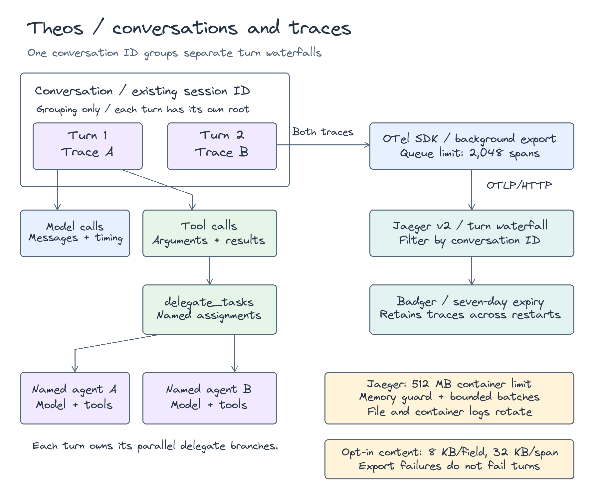
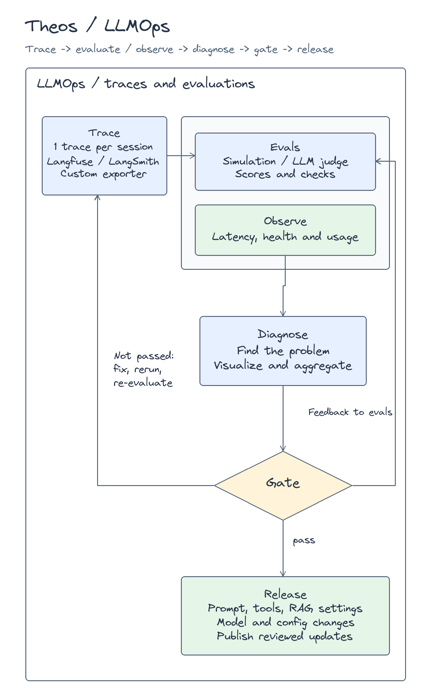

# Observability

Theos records application events, tool traces, and model usage locally.
Optional OpenTelemetry tracing exports one trace per turn through OTLP/HTTP protobuf.
The application log formatter excludes prompts, credentials, and remote error bodies.
Conversation history remains private data in SQLite and needs separate protection.

## Outputs

| Output | Location | Contents |
| --- | --- | --- |
| Application events | `AGENT_DATA_DIR/logs/theos.log` | Fixed event names, timestamps, levels, and selected metadata |
| Runtime traces | `traces` table in `theos.sqlite3` | Owner, session, event, tool name, status, and timestamp |
| OpenTelemetry spans | Configured OTLP endpoint | Turn, model, tool, delegate, and title timing with token counts and status |
| Model usage | `usage` table in `theos.sqlite3` | Owner, session, model, token counts, and optional cost estimate |
| Conversation state | `sessions` and related SQLite tables | Messages, tool arguments, results, and approval state |
| Container output | Docker logging driver | Process and HTTP server output |

Compose stores application data under `/data`.
Application events use a file handler and do not propagate to container output.
The server suppresses verbose harness and external client loggers.

## Read application events

```sh
docker compose exec theos python -c   'from pathlib import Path; print(Path("/data/logs/theos.log").read_text()[-16000:])'
```

| Event | Meaning |
| --- | --- |
| `started` | Application workers entered their lifespan |
| `turn_incomplete` | A turn reached a limit or raised an exception before its final answer |
| `delegate_incomplete` | One delegate stopped and returned available findings |
| `final_answer_unavailable` | The bounded final request failed, so the runtime returned saved findings |
| `integration_unavailable` | Optional integration discovery failed |
| `telegram_update_failed` | An accepted Telegram update failed |
| `notification_failed` | Reminder delivery failed or has an uncertain outcome |
| `scheduler_failed` | Scheduled work raised an exception |
| `trace_export_failed` | Remote trace delivery failed |

The formatter permits `error_type` and `session_id` metadata.
It does not include exception text or stack traces.
A generic error type can require a separate service check.

## Private dashboard

1. Configure a browser token in `AGENT_USERS`.
2. Add that user ID to `AGENT_ADMINS`.
3. Sign in through the browser page.
4. Open **Admin dashboard**.

`GET /api/dashboard` requires an administrator token.
It returns users, recent sessions, usage totals, recent traces, recent jobs, and the last scheduler tick.
`GET /api/logs` returns up to 100 recent application events.
There is no separate `/dashboard` page.

## View a trace waterfall

Use Jaeger v2 for a private waterfall viewer.
Its single-node Badger storage requires no separate database and retains traces across restarts.
The supplied configuration keeps spans for seven days.
See the [Jaeger storage documentation](https://www.jaegertracing.io/docs/2.22/storage/badger/).

1. Start Theos and Jaeger from the repository root.

   ```sh
   docker compose -f compose.yaml -f compose.tracing.yaml up --build -d
   ```

2. Open [Jaeger](http://127.0.0.1:16686).
3. Send a new message through Telegram, the browser, or the connected terminal.
4. Select service **theos** in Jaeger.
5. Select **Span Name → invoke_agent Theos** and find traces.
6. Open a trace to inspect the waterfall.

The operation uses the configured assistant name when it differs from `Theos`.
The browser Admin dashboard still shows SQLite events. Jaeger shows the span waterfall.
Old SQLite events do not become OTel traces.

Each turn starts a new root trace, including approval continuation and scheduled turns.
Every span includes the existing `gen_ai.conversation.id` and its `theos.turn.id`.
The root also includes transport, scheduled state, and final status.
Root attributes `theos.budget.total`, `theos.budget.research`, `theos.budget.compaction`, and `theos.budget.recovery` each have `.limit` and `.used` values.
They show reserved allowances and consumed calls, including title generation and failed provider attempts.
Delegate spans include `theos.delegate.model_calls.limit` for the configured local cap.
Use `gen_ai.conversation.id` in Jaeger's **Attributes** filter to find turns from one conversation.

OpenTelemetry defines a conversation identifier, but it does not require one trace for an entire conversation.
Its [GenAI conventions](https://github.com/open-telemetry/semantic-conventions-genai/blob/main/docs/gen-ai/gen-ai-agent-spans.md) use that identifier to correlate operations.
These conventions remain in development.
[Langfuse sessions](https://langfuse.com/docs/observability/features/sessions) also group multiple traces into one interaction.

Theos uses one trace per turn because each turn has a clear start, result, and cancellation boundary.
A conversation can remain idle for days and continue after a restart.
A conversation root would include that idle time and require a separate lifecycle policy.
Jaeger searches related turn traces by attribute. It does not provide a dedicated conversation replay page.

Model calls and executed tools are children of the turn.
Each research delegate is a child of `execute_tool delegate_tasks`.
Each delegate owns its model calls and read-only tool calls.
Parallel delegates appear as separate branches with overlapping timings.
Model spans also cover context summaries. Title generation has a separate `generate_title` span.
Approval requests and policy denials create tool spans without executing the tool.

Limit recovery adds a `finalize partial answer` span with `theos.recovery.reason` and `theos.recovery.mode`.
The mode identifies a final model request, an existing answer, or saved findings.
Any final model request appears beneath this span and has no tools.
The turn records `partial` status. An uncertain external action retains `uncertain` trace status and requires review.
Partial delegates expose their status and recovery reason. Completed sibling findings remain available to the parent.
Model-visible tool copies have character limits separate from the OTel capture limits below.
The runtime retains full durable tool results and does not repeat tools during recovery.



The exporter sends model names, tool names, call IDs, token counts, timings, status, and exception types.
Content capture is disabled by default. Set `AGENT_TRACING__CAPTURE_CONTENT=true` to include messages and tool content.
Captured traces contain private conversation data. Keep the receiver private.

| Attribute | Captured content |
| --- | --- |
| `gen_ai.system_instructions` | Model instructions as JSON text parts |
| `gen_ai.input.messages` | Model inputs, including earlier tool requests and results, as JSON roles and parts |
| `gen_ai.output.messages` | Model replies and tool requests, with names, arguments, and call IDs |
| `gen_ai.tool.call.arguments` | Validated tool arguments as JSON |
| `gen_ai.tool.call.result` | Successful tool results as JSON |
| `gen_ai.agent.name` | Parent or delegate name, also inherited by its model and tool spans |

Each captured field permits 8,192 UTF-8 JSON bytes by default. Each span permits 32,768 captured bytes in total.
The serializer bounds nesting, item counts, and traversal before encoding. It preserves valid JSON when content exceeds a limit.
`theos.content.truncated=true` identifies shortened fields or omitted messages. Model input capture retains at most the latest 32 messages in order.
The serializer masks structured credential fields. This does not remove sensitive information from arbitrary prose.
Capture excludes reasoning, image payloads, provider state, authentication headers, owner IDs, and exception text.
Failed tool messages retain their status without their error payload.

Pass named assignments to `delegate_tasks`, for example `{"tasks":[{"name":"Mumbai Weather Analyst","task":"Compare the three-day forecast"}]}`.
The delegate span uses `invoke_agent Mumbai Weather Analyst` and records its task and final answer when capture is enabled.
The delegate result includes its name. Legacy string assignments remain supported with names such as `research 1`.
Agent names follow the [OTel GenAI agent conventions](https://github.com/open-telemetry/semantic-conventions-genai/blob/main/docs/gen-ai/gen-ai-agent-spans.md).
No transient process identifier is exported as `gen_ai.agent.id`.
The exporter does not write local OTLP/JSON files.
SQLite events and usage remain available when remote tracing is disabled.

The Compose viewer and receiver bind to host loopback.
Jaeger access is separate from Theos administrator authentication.
The current setup has no Jaeger password, user accounts, or per-user trace isolation.
Anyone who can reach the viewer can inspect every stored trace, including captured conversation content.
Treat the viewer as an operator tool. Theos browser tokens do not protect its UI or query API.
Local access and authenticated SSH tunnels control network access. They do not filter traces by owner.
A reverse proxy can add login protection, but login alone does not enforce per-user trace ownership.
User-facing trace access needs a separate layer that checks conversation ownership. This layer is not implemented.
For a remote host, use private access or an SSH tunnel.

```sh
ssh -L 16686:127.0.0.1:16686 your-host
```

Use both Compose files for later lifecycle commands.
The `jaeger-data` volume is separate from application data and application backups.
The named volume has no hard disk limit. Badger expires spans after seven days.
Background maintenance reclaims expired data. Monitor volume growth separately.

## Export to another backend

The `server` extra includes the OTel SDK and OTLP/HTTP exporter.
Standalone terminal mode uses the same tracing settings.
Connected terminal mode sends turns to the server. Configure tracing on that server.

Without the Jaeger Compose override, configure these values in the server's private `.env`:

```dotenv
AGENT_TRACING__ENABLED=true
AGENT_TRACING__ENDPOINT=http://127.0.0.1:4318/v1/traces
AGENT_TRACING__SERVICE_NAME=theos
AGENT_TRACING__SAMPLE_RATIO=1
AGENT_TRACING__TIMEOUT=5
AGENT_TRACING__CAPTURE_CONTENT=false
AGENT_TRACING__CONTENT_MAX_BYTES=8192
AGENT_TRACING__SPAN_CONTENT_MAX_BYTES=32768
AGENT_TRACING__HEADERS={}
```

The endpoint is the complete trace URL, including `/v1/traces` or the backend's equivalent path.
For authenticated endpoints, set secret headers through `AGENT_TRACING__HEADERS`.
For example, use `{"Authorization":"Bearer your-token"}` in the private configuration.
The Jaeger Compose override selects `http://jaeger:4318/v1/traces` inside the container network.
For another receiver, omit that override and set the receiver's address.

Sampling defaults to every turn. A lower ratio selects whole traces, preserving their child hierarchy.
Tracing defaults to disabled and does not replace the process-wide OTel provider.
The exporter uses a background worker, a 2,048-span queue, and batches of at most 256 spans.
Graceful runtime shutdown drains the queue. Backend failures do not fail assistant turns.
An unavailable backend, a full queue, or a process crash can lose remote spans.
Remote trace export is best effort, not a durable replay queue.
Application logs record `trace_export_failed` with a safe error type when export fails.

To check a receiver without a model API request, run the disposable fake-model turn:

```sh
uv run --extra server python scripts/check_tracing.py
```

The script prints a trace ID and viewer URL.
Use `--endpoint` and `--viewer` for different receiver and UI addresses.

## Usage and cost

Model checkpoints record input, output, and cached input token counts.
Cost stays absent until both configured rates exist.

```dotenv
AGENT_INPUT_COST_PER_MILLION=0.10
AGENT_OUTPUT_COST_PER_MILLION=0.40
```

These values are illustrative, not current model prices.
Set rates appropriate for your deployment.
The calculation is input tokens times the input rate plus output tokens times the output rate, divided by one million.
Rates apply to all configured models.
The estimate does not represent an invoice or separate cached-token pricing.

## Retention

| Data | Policy | Enforcement |
| --- | --- | --- |
| Application log | 2,000,000 bytes per file, three backups | At most about 8 MB across four files |
| Application log age | Rotate the current file after seven days. Remove backups with modification times older than seven days | Startup, rotation, and hourly checks when the handler emits events |
| Container output | 5 MB per file, three files per container | Docker logging driver |
| Export queue | 2,048 spans, batches of 256 | SDK discards queued spans on overflow rather than growing without a limit |
| Jaeger spans | Seven-day expiry | Badger TTL and background maintenance |
| Jaeger memory | 512 MiB container limit, 300 MiB Go memory target | A limiter refuses ingestion above its 320 MiB soft heap threshold. Batches contain at most 256 spans |
| Jaeger storage | Persistent named volume with no hard size cap | Seven-day span expiry and background maintenance |
| SQLite events, usage, and conversation state | Keep existing records | No automatic deletion in this change |

These policies keep logs on disk and bound the queue in memory.
File age applies to whole files, not individual log records.
An idle process removes expired backups when logging resumes.
Monitor SQLite growth separately. Retained database pages do not imply that all rows reside in process memory.
The backup command excludes application logs.
Archive required diagnostic evidence separately before a restore or cleanup.

## Planned operations framework



This diagram includes planned evaluation and release feedback paths.
The current application implements local logs, tool traces, usage records, and acceptance checks.
It also implements optional per-turn OpenTelemetry spans and an OTLP/HTTP exporter.
The complete evaluation cycle remains planned.

Source: [tracing](../../src/theos/operations/tracing.py), [logging](../../src/theos/operations/logging.py), [usage](../../src/theos/runtime/usage.py), and [browser APIs](../../src/theos/transports/browser/app.py).
