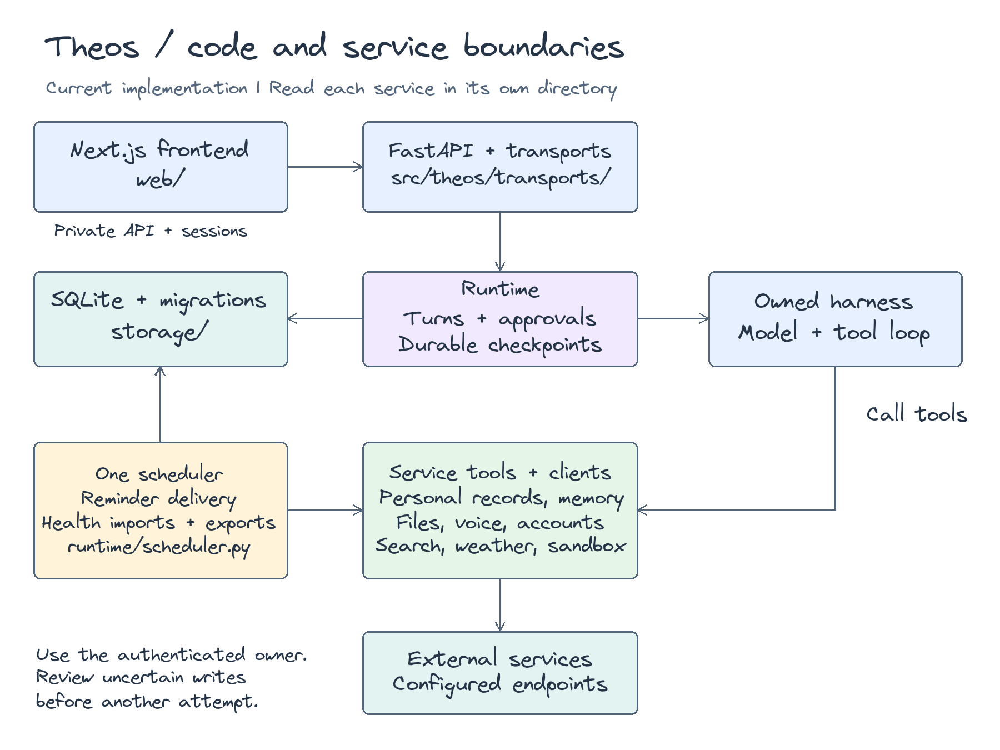
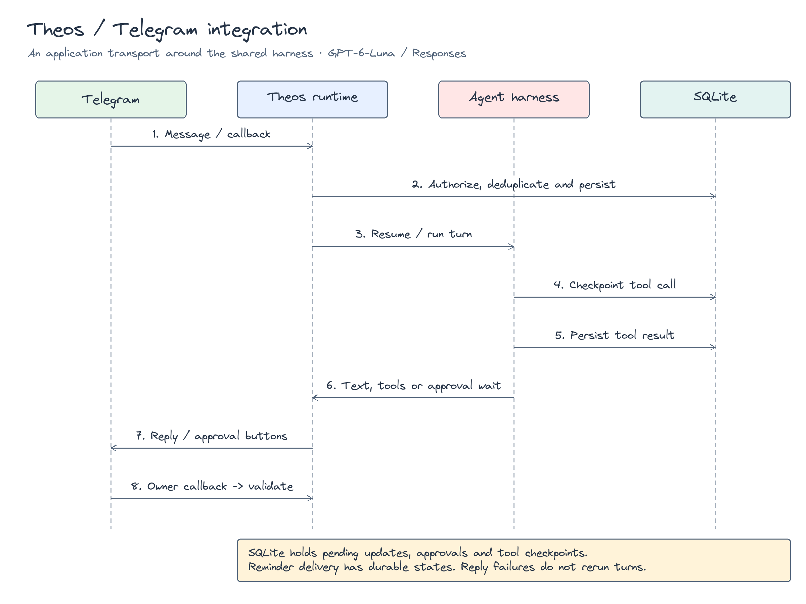

# Read the Theos code

Start with a user message, then follow the turn into its service.
Each service has its own directory under `src/theos/services`.
Small services keep their tools in one file.
Larger services separate clients, validation, and background work.

This runtime diagram is the main source navigation view.
It maps the [Agent Harness framework](architecture.md#complete-framework) to implemented services and directories.
Read the [architecture guide](architecture.md) for the full framework, memory, tools, and operations paths.

## Find a responsibility

All source paths below start at `src/theos`.

| Area | Responsibility | Start here |
| --- | --- | --- |
| Server | Start one HTTP worker and scheduler | `server.py` |
| Configuration | Validate environment settings | `settings.py` |
| Runtime | Reserve turns and run the harness | `runtime/engine.py` |
| Prompt templates | Render packaged Markdown Jinja templates and optional compaction overrides | `prompts/`, `../harness/prompts/`, `../harness/prompting.py` |
| Approvals | Match decisions to unchanged actions | `runtime/approvals.py` |
| Checkpoints | Save tool attempts and recover results | `runtime/checkpoints.py`, `runtime/hooks.py` |
| Final answers and failures | Reserve a final model call after runtime limits. Explain failures without exposing raw findings | `runtime/recovery.py`, `runtime/errors.py` |
| Context and output | Read provider capacity metadata, apply conservative OpenAI caps, and share compaction rules | `runtime/context.py` |
| Call budgets | Count calls without enforcement by default. Retain optional bounded allocations | `runtime/budgets.py` |
| Provider result shaping | Return concise account results and stage oversized reads | `services/gmail/tools.py`, `services/health/tools.py`, `services/mcp_accounts/tools.py`, `services/result_files.py` |
| Managed browser | Route browser CLI calls, isolate owner profiles, capture encrypted recovery state, and provide private sign-in controls | `services/sandbox/browser.py`, `services/sandbox/profile.py`, `transports/browser/managed_browser.py` |
| File retention | Retain recovery roots and retry deletion of unreferenced local and R2 objects | `services/files/retention.py`, migration 015 |
| History retrieval | Read exact saved messages after compaction | `../harness/tools.py` |
| Deep research | Gate explicit mode and persist reports and a separate evidence scratchpad | `runtime/research_mode.py`, `services/research/`, migrations 010 and 013 |
| Delivery events | Turn harness events into transport events | `runtime/events.py`, `runtime/turn.py` |
| Providers and usage | Build model clients, retain OpenRouter reasoning and costs, and record usage | `runtime/models.py`, `runtime/model_catalog.py`, `runtime/openrouter.py`, `runtime/usage.py` |
| Scheduler | Deliver reminders and run agent tasks, memory consolidation, and Health work | `runtime/scheduler.py`, `runtime/scheduled.py` |
| Storage | SQLite transactions, migrations, restart recovery, and application message display metadata | `storage/database.py`, `storage/messages.py`, `storage/migrations/` |
| Telegram | Poll updates, authenticate senders, onboard users, handle commands and media | `transports/telegram/` |
| Browser API | Authenticate owners and serve activity, administrator aggregates, uploads, streamed replies, OpenUI actions, and saved interface state | `transports/browser/app.py`, `transports/browser/openui.py`, `transports/browser/activity.py` |
| Next.js frontend | Render React workspace components and validated OpenUI answers, reduce streamed events, and forward private API requests | Repository root `web/src/app/`, `web/src/components/`, `web/src/openui/`, `web/src/state/`, `web/src/hooks/`, `web/src/server/` |
| Browser enrollment | Confirm Telegram-owned browser sign-in, issue hashed credentials, and revoke generated access | `storage/browser_access.py`, `transports/browser/auth.py`, `transports/telegram/web_access.py` |
| Terminal | Run `theos` as a deployed workspace client or standalone runtime, with a generic renderer | `transports/terminal/cli.py`, `remote.py`, `routes.py`, `wire.py`, `session.py`, `app.py`, `screens.py` |
| Operations | Redact logs, export OTel spans, and make consistent backups | `operations/logging.py`, `operations/tracing.py`, `backup.py` |

## Follow one turn

The harness keeps one rolling summary in `src/harness/compaction.py`.
It owns shared summary rules and initial, update, split-turn, and shortening prompts.
Production prompt text lives in `src/harness/prompts/`. Theos templates live in `src/theos/prompts/`.
The runtime passes optional Theos prompt overrides through `CompactionConfig`.
Read [prompt templates](runtime/prompts.md) for filenames, rendering, and override fields.
Split turns use separate history and turn-prefix summaries, combined into one checkpoint before the retained messages.
It builds a smaller model view and leaves the saved transcript unchanged.
The runtime supplies model settings and persistence and usage callbacks in `runtime/context.py`.
Research records stay in the separate `services/research/` scratchpad.
Inline ASCII diagrams in `src/harness/compaction.py` show coverage, split-turn summaries, and model context order.
The comments number the fit workflow and explain tool-batch retention and checkpoint rollback.
The loop and runtime context modules show request flow and callback ownership.

1. Read `Telegram.handle()` or the browser chat route to see how the transport identifies the owner.
2. Read `Runtime.start()` to see the ownership checks and conversation reservation.
3. Read `Runtime.run()` to follow its five numbered steps.
4. Read `runtime/tools.py` to see which services the conversation can access.
5. Read the selected service's `tools.py` to follow its validation and action.
6. Read `runtime/hooks.py` to find the durable model and tool checkpoints.
7. Read `runtime/events.py` to follow text, progress, approval, and file delivery.

The runtime allows one active turn per conversation.
A shared semaphore limits concurrent turns across conversations.
The event queue can discard old display events when a client stops reading.
SQLite retains the durable conversation and tool state.
The standalone terminal requests raw harness events through its turn queue.
Its adapter converts these events for the generic renderer under `src/renderer`.
The adapter uses the same runtime tools, checkpoints, and approval policy.
It restores approval prompts after restart and keeps local owner identities separate from Telegram and browser owners.
Connected terminal mode uses `remote.py` to call authenticated HTTP endpoints on the deployment.
`routes.py` binds these calls to the browser owner and shared browser conversations.
`wire.py` converts raw harness events into display-only JSON without provider state or harness run results.
The client never opens SQLite or starts another scheduler. Disconnects leave server work running.
`ClientSettings` reads only the server URL and token before the command loads standalone service settings.
`screens.py` owns terminal settings and usage dialogs. The application adds commands through generic renderer extension points.
`runtime/openui.py` loads generated prompt artifacts from `prompts/openui/`. The browser renderer saves interface state and summaries as display metadata. `transports/terminal/openui.py` replaces browser source with the saved summary or a browser notice.

## Work within a service

| Service directory | Contents |
| --- | --- |
| `preferences/` | Timezone, calorie goal, display name, and instruction override |
| `reminders/` | Reminder tools and explicit handling of ambiguous local times |
| `schedules/` | Owner-scoped scheduled agent task tools and recurrence validation |
| `meals/` | Meal validation, saved records, daily totals, and export intent |
| `training/` | Program validation, versions, workout history, and metrics |
| `custom_tables/` | Private SQLite tables and bounded query templates |
| `memory/` | Mem0 HTTP client, ownership checks, bounded retrieval, consented consolidation, and explicit tools |
| `search/`, `weather/`, `skills/` | Search fallback, forecasts, and bounded skill resources |
| `files/` | Private catalog, image validation, automatic R2 replication, model checkpoints, and response attachments |
| `voice/` | Transcription and Kokoro clients with audio tools |
| `sandbox/` | Remote lifecycle client, command and attachment tools, model image inspection, owner browsers, and versioned task workspaces |
| `google/` | Shared Google OAuth state, token encryption, refresh, and disconnection |
| `gitlab/` | Official MCP configuration, instance validation, and reviewed read tools |
| `github/` | Official MCP configuration, reviewed read tools, signed event queue, per-owner subscriptions, and literal notifications |
| `slack/` | Official Slack MCP endpoint, OAuth configuration, and reviewed read-tool allowlist |
| `mcp_accounts/` | Shared encrypted account grants, PKCE state, remote sessions, and schema validation |
| `gmail/` | Gmail requests, draft previews, and account tools |
| `health/` | Imports, normalization, records, nutrition exports, job retries, and tools |
| `zepto/` | OAuth, encrypted owner tokens, MCP discovery, and account-scoped sessions that serialize tool calls |

`storage/account_access.py` permits configured browser identities and authorized private Telegram identities.
`transports/telegram/connections.py` owns native account cards, sign-in buttons, status actions, and Zepto reply prompts.
`polling.py` identifies prompt replies before inbox persistence and routes encrypted return links outside model history.
`transports/browser/connections.py` binds account actions to the authenticated browser owner.
`transports/browser/github_events.py` receives signed GitHub webhooks and manages private notification settings.
`services/github/events.py` selects attention events. `notifications.py` owns routing, access checks, queue retention, and delivery status.
The Next.js webhook route forwards exact bytes without browser credentials. The scheduler runs the independent GitHub worker.
`services/account_setup.py` shares optional account offers and profile completion across browser and Telegram.
It reports configuration status without exposing credentials.
Groups and standalone terminal sessions receive no account tools.
Connected terminal clients use the authenticated browser user's existing account access.
Configured browser IDs cannot overlap reserved Telegram and terminal namespaces.
Generated browser credentials reuse the verified Telegram owner's private records and account access.
Telegram and browser conversation threads remain separate.

`services/personal.py` and `services/information.py` only collect related tools.
They contain no database rules or external requests.

`runtime/speech.py` writes expressive spoken renditions through the configured model and records their usage.
The voice service calls this step before browser or tool synthesis. Display text and history remain unchanged.
The separate `speech/` project owns the optional Kokoro gateway and its audio effects on the speech host.
The runtime creates clients explicitly and closes them during shutdown.
`runtime/scheduled.py` claims durable scheduled occurrences and delivers ordinary runtime turns.
`services/memory/automation.py` owns retrieval, consent policy, and consolidation batches.
No service registry or inheritance hierarchy hides those dependencies.

For Google Health, read these files in order:

1. Read `client.py` for account requests and service entry points.
2. Read `imports.py` for pagination and complete summary storage.
   `normalize.py` and `vitals.py` normalize daily records and sample statistics with explicit units.
3. Read `queue.py` for export intent saved with a meal transaction.
4. Read `nutrition.py` for the six numbered reconciliation steps.
5. Read `jobs.py` for ordering, retry delay, and cancellation checks.

## Check approvals and recovery

The approval policy matches the saved call, arguments, decision, expiry, and review contents.
Gmail sending and Zepto payment, cart confirmation, checkout, and order placement tools require approval.
Gmail checks the reviewed draft during approval and immediately before sending.
The final read cannot lock the draft against edits from another client.

A tool attempt enters SQLite before execution starts.
The after-tool hook saves its result before the next model request.
After a restart, unfinished tool calls have an unknown outcome.
The runtime does not repeat them automatically.
Health jobs inspect named remote records before another write.

The Telegram polling loop has three numbered steps: receive, save, and dispatch.
It saves updates and the polling offset in one transaction.
An interrupted reply does not cause another model turn.
`transports/telegram/onboarding.py` reserves user slots and asks for a preferred name and timezone before normal routing.
Owner-scoped preferences retain the chosen name across restarts and conversation resets.
`runtime/engine.py` supplies the saved display name to the model on each turn.
`storage/telegram_access.py` checks SQL authorization and removes access-code arguments before inbox storage.
Commands, account tool registration, and OAuth callbacks use the same private account access check.
SQLite counts unique senders, including incomplete setup, against a maximum of 50 Telegram users.

This sequence explains checkpoint order.
The current transport records durable inbound updates and reminder delivery state.
It does not have a general durable outbox for every streamed reply.

## Write readable changes

Use comments for constraints that a reader cannot infer from an assignment.
Explain ownership checks, transaction boundaries, retry rules, and provider behavior.
Number the major steps in an ordered workflow.
Keep each numbered comment close to the code it explains.

Use ordinary functions for stateless work.
Use a small class when it owns clients, locks, or other lifecycle state.
Keep existing entry points working when moving internal files.
Run the [acceptance checks](runtime/acceptance.md) after changing a service boundary.

The rolling summary uses a 50% context trigger and keeps a 2.5% recent tail.
Covered user requests enter the checkpoint. They are not repeated after it.
New unanswered requests and unfinished tool batches remain verbatim.
On provider overflow, the harness asks for shorter summary tiers and retries without repeating tools.
`history_read` and `history_search` live with the other generic tools in `src/harness/tools.py`.
Gmail body decoding lives in `services/gmail/content.py`.
Research evidence lives in `research_scratchpad` and remains separate from compaction.
Runtime events expose scoped compaction activity. Transport renderers own its display and readable approval reviews.
Assistant storage and sandbox dependencies stay under `src/theos/services`.

`src/harness/limits.py` defines tool argument bounds and the execution batch size, default 16.
`loop.py` processes every valid call in ordered batches and retains each batch's results before the next batch.
`tools.py` preserves approval checks and bounds parallel groups. Tools without a parallel safety declaration remain serial.
Invalid calls receive `not_started` results with correction instructions. Executed failures and uncertain outcomes retain separate statuses.
Model instructions request smaller groups and explain when an oversized group was split. Call IDs and saved transcripts remain unchanged.
