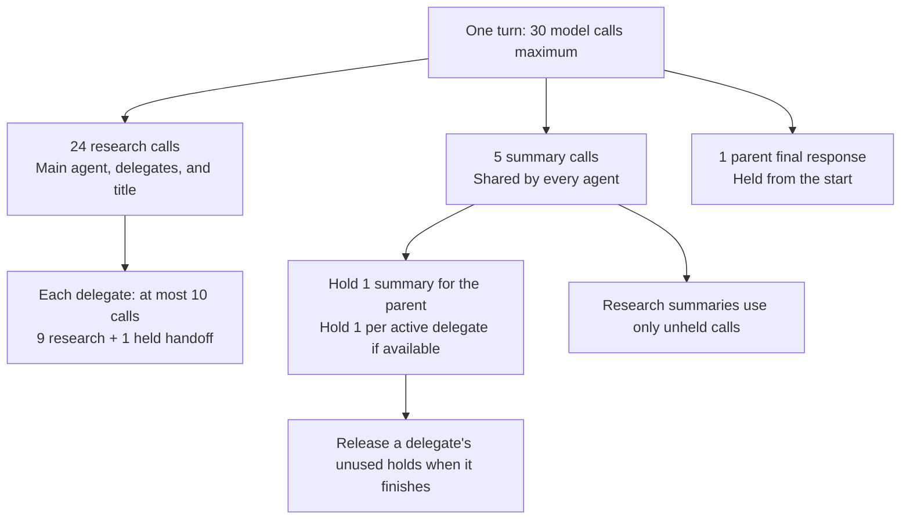
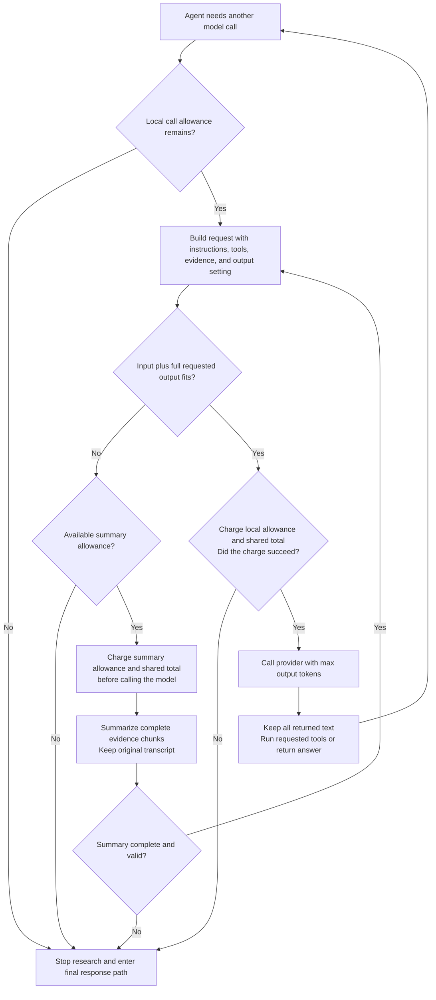
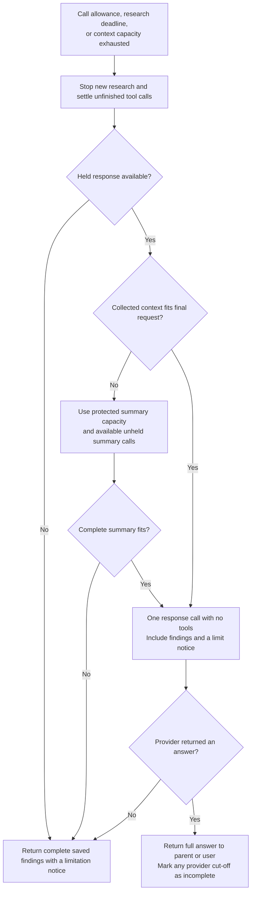

# Call budgets

Each user message starts one shared call budget. Normal questions and explicit deep research use the same budget rules.
A delegate does not receive an extra pool of calls.
Open the [Excalidraw overview](call-budgets.excalidraw) for the same allocation map.

## Default allocation

The 24 research calls include the parent's calls and every delegate's calls.
Each delegate holds its handoff before any sibling starts. Its handoff consumes one of those 24 calls.
A delegate that cannot hold a handoff does not start research.
The parent holds a separate final response within the 30-call total.
A normal parent answer consumes a research call. The held parent response is for limits or interrupted research.

Summary holds also come from the existing five calls. They do not increase the total.
With three active delegates, four summary calls are held and one remains available for ordinary summaries.
A completed delegate releases unused holds. Later research summaries can use those released calls.
The parent's summary hold stays available until its final response or the end of the turn.
A final response uses its held summary first, then any unheld summary calls still available.

## Before every request

Ordinary research also summarizes at 60 percent of context capacity, with a configurable threshold from 50 to 70 percent.
The diagram's size check is the additional requirement that input plus the full requested output fits.
After a summary, the harness rebuilds the complete request and checks it again, up to four passes.
The final response summarizes only when its input plus requested output cannot fit.
The application never lowers the output setting to force a request to fit.

The loop checks the local allowance before preparing a request.
It charges the allowance immediately before the provider call.
Both checks matter because concurrent delegates can consume shared calls between those steps.
The charge updates the local allowance and shared total together, without an asynchronous gap.
Each summary chunk charges the summary allowance and shared total immediately before its provider call.
An attempted provider call counts even if the provider fails.

## When research stops

The held summary is a protected opportunity, not a promise that any amount of evidence will fit.
Several chunks can need several summary calls. Large original requirements can also exceed the model window.
If summaries fail or cannot fit, the application retains the evidence and returns saved findings.
It does not retry the final response or cut the text to force a fit.
Provider failures return saved findings without another research attempt.
Explicit cancellation interrupts the turn instead of starting a final response.

## Configuration and accounting

| Setting | Default | Where the harness enforces it |
| --- | --- | --- |
| `AGENT_MAX_MODEL_CALLS` | `30` | Shared ceiling charged by every research, summary, title, and final response call |
| `AGENT_MAX_COMPACTION_CALLS` | `5` | Shared summary allowance, including protected summary holds |
| `AGENT_DELEGATE_MAX_MODEL_CALLS` | `10` | Each delegate's local allowance, including its held handoff |
| Parent final response | `1` | Held automatically within the total. Legacy `AGENT_MAX_RECOVERY_CALLS` does not add attempts |
| `AGENT_TURN_TIMEOUT` | `300` seconds | Before new main-agent model calls and tools |
| Delegate research deadline | `85` seconds | Before new delegate model calls and tools, also bounded by the parent's research deadline |
| Ordinary tool timeout | `90` seconds | Tool execution. Delegation groups permit active final responses to finish |
| `AGENT_COMPACTION_TRIGGER_RATIO` | `0.6` | Ordinary context preparation. Summaries target 45 percent of capacity |
| Conversation `max_output_tokens` | Provider maximum when known | Provider generation parameter, including answer and summary requests |

For smaller totals, summary allocation is `min(configured summaries, max(total - 2, 0))`.
The parent still holds one final response. Research receives the remaining calls.
A total of one therefore permits only the final response.
Unused summary calls do not become research calls.

Tools do not consume model-call slots themselves. The model call that selects a tool does.
A delegated tool can start child model calls, which consume the same shared allowance.
Title generation consumes a research slot. It can be skipped when that allowance is exhausted.
Provider SDK connection retries remain inside a charged model call. This ceiling counts harness model calls, not individual HTTP attempts.
Memory-service calls, search requests, and account APIs are separate service requests.

For agents, only the provider's max output tokens parameter enforces generation length.
The application does not cut or reject returned answers by size.
When no output value is known, one shared 8,192-token estimate reserves context space without setting a generation limit.
Tracing has separate capture limits that do not change answers.

Code: [allocation](../../src/theos/runtime/budgets.py), [delegates](../../src/theos/runtime/tools.py),
[request checks](../../src/harness/loop.py), [summary calls](../../src/harness/compaction.py),
and [final responses](../../src/theos/runtime/recovery.py).
