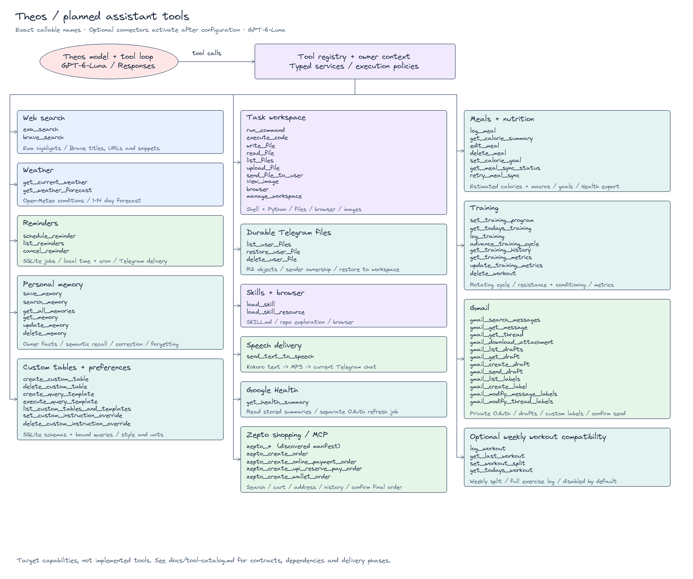

# Implemented tool catalog

The runtime binds tools to the authenticated owner and conversation.
A model cannot supply another owner ID through tool arguments.
Optional account tools appear only after configuration and transport checks.
Read the [service setup guide](services.md) for endpoints and credentials.
The [configuration reference](base-infra/environment-variables.md) lists every environment setting.
Use the [documentation map](documentation-map.md) to find each service guide.

This diagram shows how tool groups fit into the framework.
It preserves earlier design names and planned delivery phases.
The tables below describe the current implementation.
Read the [runtime diagram](architecture.md#current-implementation) for service ownership.

## Telegram release check

`python -m theos.operations.telegram_check` uses HTTPX and the Python standard library.
The optional `--env-file` argument uses python-dotenv, already installed through Pydantic Settings.
The check calls Telegram's read-only `getMe` and `getWebhookInfo` methods with ten-second request timeouts.
It checks bot authentication and rejects active webhooks that prevent polling.
It sends no messages, reads no updates, and prints no credentials or remote error bodies.
The Pi release runs the check before stopping the worker and after activating the candidate.
An empty bot token disables the check. This operation adds no model tool or package dependency.

Source: [connection check](../src/theos/operations/telegram_check.py) and [release activation](../scripts/deploy_rpi.py).

## Terminal transport

The installed `theos` command uses the owned renderer, Rich, and Textual.
The `terminal` extra installs standalone application dependencies.
The smaller `client` extra installs HTTPX, Pydantic Settings, Rich, and Textual for deployed workspace access.
Connected mode reads only the server URL and token. Model SDKs and account credential encryption stay on the server.
Connected mode authenticates with the browser token and uses the deployment's shared conversations, tools, settings, usage, and approvals.
HTTP Server-Sent Events carry display events with nested delegate scope. They omit provider state and harness run results.
The client uses native Textual settings and usage dialogs and supported model and reasoning option menus.
It starts no local runtime, SQLite connection, scheduler, or Telegram poller.
Disconnects leave server work running. Requests and approval decisions have no automatic retry.
Standalone mode saves transcripts and metadata under a local `terminal:` owner.
That mode uses the existing file catalog, runtime tools, approval policy, and scheduler.
It adds no model tools.
Read the [terminal guide](terminal.md) for installation and controls.

Source: [terminal adapter](../src/theos/transports/terminal/session.py), [remote client](../src/theos/transports/terminal/remote.py), [authenticated routes](../src/theos/transports/terminal/routes.py), and [command lifecycle](../src/theos/transports/terminal/cli.py).

## Browser tools view

The browser uses FastAPI and native HTML details controls.
It reads the current conversation's runtime registry without executing tools.
The view shows tool descriptions, input schemas, and approval requirements.
Chat shows collapsible tool calls and model reasoning summaries when available.
SQLite usage records supply owner totals and administrator cost breakdowns.
`/api/activity` uses the browser token to scope charts and totals to one owner.
`/api/dashboard` requires administrator access and includes all users and transports.
Administrator usage responses exclude conversation titles and message history.
Message footers use provider output-token usage, streaming estimates, and elapsed generation time.
The application saves UTC timestamps and durations in history JSON through `storage/messages.py`.
Native browser timers and Intl formatters supply live updates and local timestamps.

Markdown uses locally served [Marked](https://marked.js.org/) 18.1.0 and [DOMPurify](https://github.com/cure53/DOMPurify) 3.4.16.
The [vendor manifest](browser-vendor-provenance.json) records pinned package sources, file hashes, and included license files.
The renderer treats raw HTML as text and removes unsafe links from generated markup.

Native SVG, ResizeObserver, and HTML data tables supply responsive dashboard charts.
`transports/browser/activity.py` aggregates usage and tool-start records for bounded UTC periods.
Personal queries use the authenticated owner. Administrator queries cover the workspace.

Web Audio MediaStreamAudioSourceNode and AnalyserNode measure microphone RMS volume for the accent recording glow.
Reduced motion and unsupported audio analyzers retain a static glow.
These UI features add no Python dependency or model tool.

Browser commands use the existing authenticated conversation APIs.
Native HTML dialogs supply Settings, command help, and usage cards. Native SVG supplies the settings and sidebar icons.
These controls add no runtime dependency. Settings saves model, reasoning, generation, and voice choices together.
Generation controls use Pydantic validation and SQLite migration 006.
Automatic titles use bounded, tool-free requests to the selected model and SQLite migration 007.
Their token usage is included in the conversation cost.
OpenRouter aliases and parameter support live in [the model catalog](../src/theos/runtime/model_catalog.py).
Microphone input uses browser MediaRecorder and the existing transcription client.
Speech playback uses the existing Kokoro client and authenticated file catalog.
The [OpenRouter adapter](../src/theos/runtime/openrouter.py) retains streamed reasoning, signed reasoning blocks, and provider-reported costs.

Source: [browser API](../src/theos/transports/browser/app.py) and [browser controls](../src/theos/transports/browser/static/app.js).

## Browser connections

Native HTML controls and authenticated FastAPI routes expose account consent, setup status, cancellation, and disconnection.
Google uses the existing HTTPX OAuth client, PKCE, and encrypted SQLite credentials.
Zepto uses the existing MCP OAuth client and owner-bound return handoff.
The view also reports optional service configuration without secrets.
Composer `@` suggestions use these same owner-bound connection statuses.
Mentions remain user text and do not grant tool access or approve actions.
Provider icons are local assets. The [provider manifest](browser-provider-provenance.json) records their sources and hashes.
These controls add no Python dependency or model tool.
Configured sandbox tools work in browser conversations and retain execution approvals.

Source: [connection routes](../src/theos/transports/browser/connections.py), [account access](../src/theos/storage/account_access.py), and [browser controls](../src/theos/transports/browser/static/app.js).

## Preferences

SQLite. The timezone uses the Python zoneinfo database.
Telegram `/start` asks for a preferred name and timezone before normal chat.
The saved display name enters owner-scoped model context on each turn.
`/skip` accepts the saved or Telegram name, then the saved default timezone in the next step.
The transport uses SQLite enrollment records to enforce a maximum of 50 Telegram users.
An optional `AGENT_TELEGRAM_ACCESS_CODE` protects registration and later access through SQL authorization records.
The transport uses Python hashlib and hmac to verify codes and store fingerprints.
Completed users can connect private accounts without a manual sender allowlist.
This setup uses no model tool or additional service dependency.

Source: [service tools](../src/theos/services/preferences/tools.py).
See [Telegram onboarding](telegram-setup.md#user-onboarding-and-limit) for the transport flow.

Telegram-confirmed browser access uses existing FastAPI, HTTPX, SQLite, hashlib, and secrets dependencies.
`AGENT_WEB_URL` supplies the validated deployment origin.
Private Telegram approval binds a single-use invitation to a browser cookie before credential issuance.
SQLite stores only credential hashes. Session cookies are HttpOnly and SameSite Strict, with Secure enabled on HTTPS.
Cookie mutations require a custom same-origin request header and reject foreign origins.
Personal access tokens retain the existing bearer-token login interface.
This flow adds no model tool and makes no encryption decision.

Source: [credential storage](../src/theos/storage/browser_access.py), [browser sign-in](../src/theos/transports/browser/auth.py), and [Telegram web access](../src/theos/transports/telegram/web_access.py).
The cookie controls follow [OWASP session guidance](https://cheatsheetseries.owasp.org/cheatsheets/Session_Management_Cheat_Sheet.html).

| Callable | Action |
| --- | --- |
| `set_preference` | Set your timezone, calorie goal, display name, or instruction override. |
| `get_preferences` | Read your preferences and instruction override. |

## Reminders

SQLite and croniter. The application scheduler delivers saved occurrences.

Source: [service tools](../src/theos/services/reminders/tools.py).

| Callable | Action |
| --- | --- |
| `schedule_reminder` | Schedule a reminder. Recurrence is a five-field cron expression in your timezone. |
| `list_reminders` | List your pending reminders and their delivery status. |
| `cancel_reminder` | Cancel one of your reminders. |

## Meals

SQLite and Pydantic. Connected Google Health accounts receive durable export jobs.

Source: [service tools](../src/theos/services/meals/tools.py).

| Callable | Action |
| --- | --- |
| `log_meal` | Save a meal with calories, nutrients, and the time you ate it. |
| `edit_meal` | Replace a saved meal and queue its nutrition export. |
| `delete_meal` | Delete a meal and queue deletion of its exported nutrition record. |
| `get_calorie_summary` | List meals and nutrient totals for a day in your timezone. |

## Training

SQLite and Pydantic. Program versions preserve the meaning of past workouts.

Source: [service tools](../src/theos/services/training/tools.py).

| Callable | Action |
| --- | --- |
| `set_training_program` | Save a rotating program with resistance, cardio, recovery, and rest days. |
| `get_todays_training` | Read today's prescription, deload state, and last comparable workout. |
| `advance_training_cycle` | Advance the training program by one day, including its week counter. |
| `log_training` | Save training results, per-set details, metrics, and completion status. |
| `get_training_history` | List comparable workouts by cycle day, session type, or exercise. |
| `delete_workout` | Delete one of your saved workouts. |
| `update_training_metrics` | Record a training metric with an explicit unit and measurement time. |
| `get_training_metrics` | List your training metrics and measurement history. |

## Custom Tables

A separate SQLite database per owner. Queries use bound parameters and an authorizer.

Source: [service tools](../src/theos/services/custom_tables/tools.py).

| Callable | Action |
| --- | --- |
| `create_custom_table` | Create a table in your private database. |
| `delete_custom_table` | Delete a table and its rows after confirmation. |
| `create_query_template` | Save one SELECT, INSERT, UPDATE, or DELETE statement with named parameters. |
| `execute_query_template` | Run a saved query with bound parameters in your private database. |
| `list_custom_tables_and_templates` | List your tables and saved query templates. |

## Memory

HTTPX and the configured Mem0 OSS REST endpoint. Mem0 Platform needs an adapter.
Returned records require matching owner metadata. The OSS API key does not bind `user_id` to its dashboard user.

Source: [service tools](../src/theos/services/memory/tools.py).

| Callable | Action |
| --- | --- |
| `save_memory` | Save information that the user explicitly wants to remember. |
| `search_memory` | Search your saved memories. |
| `get_all_memories` | List your saved memories. |
| `get_memory` | Read one of your saved memories. |
| `update_memory` | Replace one of your saved memories. |
| `delete_memory` | Delete one of your saved memories. |

## Search

HTTPX with Exa, then Brave when configured. At least one search key is required.

Source: [service tools](../src/theos/services/search/tools.py).

| Callable | Action |
| --- | --- |
| `web_search` | Search with Exa. Use Brave if Exa fails or is not configured. |

## Weather

HTTPX with the Open-Meteo geocoding and forecast APIs.

Source: [service tools](../src/theos/services/weather/tools.py).

| Callable | Action |
| --- | --- |
| `get_weather` | Get current weather and a daily forecast for a place. |

## Skills

An operator-controlled directory. Resource reads cannot escape the selected skill directory.

Source: [service tools](../src/theos/services/skills/tools.py).

| Callable | Action |
| --- | --- |
| `list_skills` | List the skill instructions installed by the operator. |
| `load_skill` | Read a skill or a resource inside its directory. |

## Files

Private SQLite catalog and local files. R2 operations also use boto3 and configured bucket credentials.

Source: [service tools](../src/theos/services/files/tools.py).

| Callable | Action |
| --- | --- |
| `list_user_files` | List your uploaded and generated files. |
| `archive_user_file` | Archive a file in the configured R2 bucket. |
| `restore_user_file` | Restore one of your archived files. |
| `delete_user_file` | Delete your file from local storage and R2. |

## Voice

HTTPX with configured transcription and Kokoro endpoints. Generated audio enters the private file catalog.

The [speech hosting guide](speech-hosting.md) covers separate Docker and native deployments.
Docker uses Speaches with faster-whisper and Kokoro-FastAPI CPU images.
Native Apple Silicon uses MLX Whisper and Kokoro-FastAPI through PyTorch MPS, with uv, FFmpeg, and espeak-ng.
Hosted transcription uses a compatible multipart API with bearer authentication.
The speech client fixes the model to `kokoro` and sends no authentication header.
Generic hosted speech APIs require an adapter or client changes.

Source: [service tools](../src/theos/services/voice/tools.py).

| Callable | Action |
| --- | --- |
| `send_text_to_speech` | Generate speech with Kokoro and deliver it as a file. |
| `transcribe_file` | Transcribe an uploaded audio file. |

## Sandbox

OpenSandbox and its code interpreter SDK. Browser commands require agent-browser inside the remote image.

Source: [service tools](../src/theos/services/sandbox/tools.py).

`AGENT_SANDBOX__USE_SERVER_PROXY=true` routes SDK execution and file requests through the OpenSandbox server.
This uses the existing SDK and lets remote clients connect without access to container ports.

| Callable | Action |
| --- | --- |
| `sandbox_run_command` | Run a shell command in your remote sandbox after confirmation. |
| `sandbox_execute_code` | Run Python in your remote sandbox's persistent interpreter. |
| `sandbox_write_file` | Write a text file in the remote sandbox. |
| `sandbox_read_file` | Read a text file from the remote sandbox. |
| `sandbox_list_files` | List files in a remote sandbox directory. |
| `sandbox_send_file_to_user` | Download a generated sandbox file and deliver it to the user. |
| `sandbox_view_image` | Read a sandbox image and attach it to the next model request. |
| `sandbox_upload_file` | Copy one of your uploaded files into the remote sandbox. |
| `sandbox_browser` | Run agent-browser in the sandbox. Use snapshot, open, click, fill, or screenshot commands. |
| `sandbox_lifecycle` | Inspect, extend, destroy, or forget an expired sandbox. |

## Gmail

HTTPX, Google OAuth, and encrypted owner tokens. Tools require a browser or private Telegram conversation.

Source: [service tools](../src/theos/services/gmail/tools.py).

| Callable | Action |
| --- | --- |
| `gmail_connect` | Create a Google authorization link for your Gmail account. |
| `gmail_disconnect` | Disconnect your Gmail account and revoke its grant. |
| `gmail_search_messages` | Search Gmail messages outside Spam and Trash. |
| `gmail_get_message` | Read a Gmail message, including its MIME body and attachment IDs. |
| `gmail_get_thread` | Read a Gmail thread outside Spam and Trash. |
| `gmail_download_attachment` | Download an attachment from one of your accessible messages. |
| `gmail_list_drafts` | List your Gmail drafts. |
| `gmail_get_draft` | Read a draft with its recipients, subject, body, and content hash. |
| `gmail_create_draft` | Create a draft. Sending requires a separate user approval. |
| `gmail_send_draft` | Send a reviewed draft only after explicit approval of its current contents. |
| `gmail_list_labels` | List Gmail labels. |
| `gmail_create_label` | Create a Gmail label. |
| `gmail_modify_labels` | Add or remove labels on a message or thread. |

## Health

HTTPX, Google OAuth, and encrypted owner tokens. Tools require a browser or private Telegram conversation.

Source: [service tools](../src/theos/services/health/tools.py).

| Callable | Action |
| --- | --- |
| `health_connect` | Create an authorization link for Google Health. |
| `health_disconnect` | Disconnect Google Health and stop pending imports and exports. |
| `get_health_summary` | Read your latest seven-day health import, or request a refresh. |
| `get_meal_sync_status` | List nutrition export states, including uncertain writes. |
| `retry_meal_sync` | Queue failed exports for reconciliation before any retry. |
| `backfill_nutrition` | Queue historical meals that have no backfill marker. |

## Zepto

Streamable HTTP MCP, OAuth, JSON Schema validation, and encrypted owner credentials.

Source: [service tools](../src/theos/services/zepto/tools.py).

Each user connects Zepto from the browser Connections view or a private Telegram chat.
The client discovers remote tools and registers them with the `zepto_` prefix.
It excludes the `zepto_shop` wrapper and validates arguments against each remote schema.
All exposed Zepto calls require approval, including order and payment actions.
Product search needs a selected delivery store.
Use `zepto_list_saved_addresses` and `zepto_select_saved_address` for the user's chosen address.
Use `zepto_get_location_serviceability` for a new delivery location's coordinates.
The tools explain the known missing-store error without exposing arbitrary remote error bodies.
Each account retains its own MCP session to preserve the selected store between calls.
Calls run in order. Failed or canceled calls do not replay automatically.

## Delegated research

`delegate_tasks` runs up to three research tasks with the parent's model-call budget.
Delegates receive search, weather, and skill tools only.
They cannot create more delegates or change account data.
Source: [runtime tool registration](../src/theos/runtime/tools.py).

## Scheduled agent tasks

SQLite, croniter, and the normal agent runtime execute one-time or recurring tasks.
The scheduler owns occurrence claims and delivery status.
Source: [task tools](../src/theos/services/schedules/tools.py) and [dispatch](../src/theos/runtime/scheduled.py).

| Tool | Action |
| --- | --- |
| `schedule_task` | Schedule a named agent task in the creating conversation |
| `list_scheduled_tasks` | List the owner's schedules |
| `pause_scheduled_task` | Pause future runs |
| `resume_scheduled_task` | Resume a paused schedule from a future time |
| `cancel_scheduled_task` | Cancel future runs without deleting history |
| `list_scheduled_runs` | Read execution and delivery states |

## Memory automation

HTTPX supplies bounded owner-scoped retrieval before private-chat model calls.
SQLite queues consented user text for Mem0 OSS fact extraction and consolidation.
The worker uses the existing Mem0 inference, embedding, and vector-store dependencies.
Source: [memory automation](../src/theos/services/memory/automation.py).

| Tool | Action |
| --- | --- |
| `configure_memory_automation` | Set retrieval and consolidation policy after approval |
| `get_memory_automation_status` | Read owner policy and batch status counts |

## Approval boundary

The runtime requires approval for these actions:

- `gmail_send_draft`
- `delete_custom_table`
- `delete_user_file`
- `sandbox_run_command`
- `sandbox_execute_code`
- `sandbox_browser`
- `configure_memory_automation`
- Every registered `zepto_` tool

Approvals expire after 15 minutes and bind to the saved arguments.
Gmail also binds approval to the draft preview and rechecks it before sending.
An uncertain external write requires review before another attempt.
Source: [approval policy](../src/theos/runtime/approvals.py).
