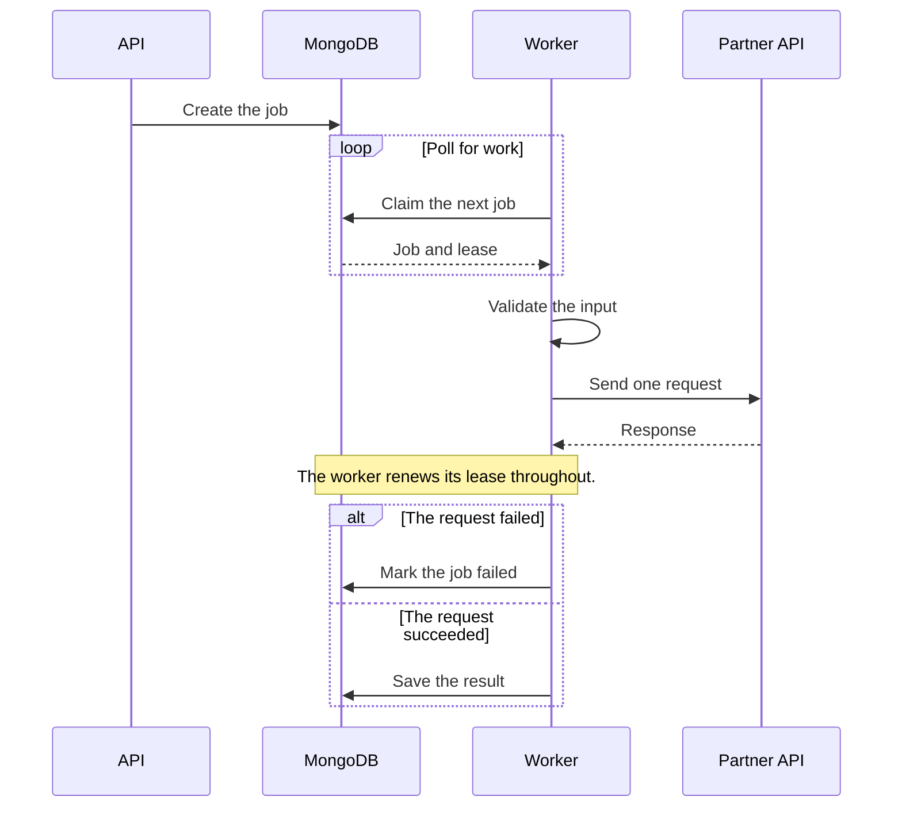

## 1. Purpose

This document shows each element of the house style. Copy it as the start of a new document.

**Who should read this document.**

- Engineers who change the service.
- Operators who deploy it.

## 2. Decisions

| Area | Decision |
| --- | --- |
| Store | MongoDB with transactions |
| Queue | Built on MongoDB. No separate queue service. |
| `EVAL_SLOTS` | `1` by default |

!!! note "Reuse test."
    A second team can adopt the service with a new config only. No code change.

## 3. Flow

```flow
<div class="fig flow" data-edges='[
 {"from":"x-user","to":"x-api","fx":"align","label":"HTTPS"},
 {"from":"x-api","to":"x-worker"},
 {"from":"x-worker","to":"x-child"},
 {"from":"x-svc","to":"x-db","fx":"align","label":"state","lp":"end"},
 {"from":"x-svc","to":"x-ext","fx":"align","dash":true,"label":"optional","lp":"end"}
]'>
  <div class="row-start" style="margin-bottom:30px"><div class="box ext" id="x-user" style="width:140px"><b>User</b><span>browser</span></div></div>
  <div class="zone" id="x-svc">
    <div class="zlabel" style="left:auto;right:12px">Service · one container</div>
    <div class="row3">
      <div class="box primary" id="x-api"><b>API</b><span>HTTP control plane</span></div>
      <div class="box" id="x-worker"><b>Worker</b><span>long-running</span></div>
      <div class="box child" id="x-child"><b>Child</b><span>isolated</span></div>
    </div>
  </div>
  <div class="row3" style="margin-top:44px">
    <div class="box store" id="x-db"><i>store</i><b>MongoDB</b><span>durable state</span></div>
    <div></div>
    <div class="box ext" id="x-ext"><b>Partner API</b><span>outside the system</span></div>
  </div>
  <div class="bar">Workers poll MongoDB. Nothing pushes work.</div>
</div>
```

### 3.1 One request



## 4. Steps

1. Write the Markdown.
2. Run the build script.
3. Look at every page.
