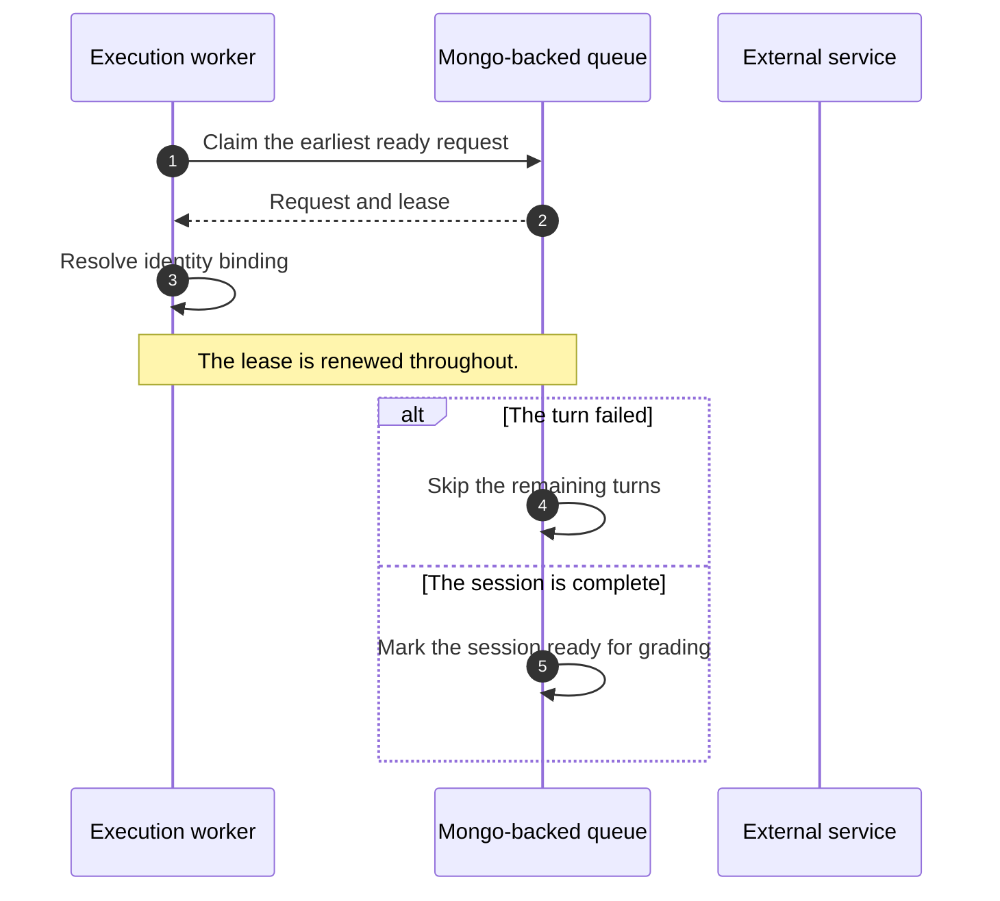

# Sequence diagrams

Write a sequence diagram as an ordinary Mermaid block. `build_doc.py` parses it and draws it in
the house style with HTML and CSS. It does not run Mermaid. So the source stays readable in
GitHub or MkDocs, and the PDF matches the rest of the document.

````markdown

````

## Supported syntax

- `participant X as Label` and `actor X`. An actor is drawn as an external, dashed participant.
- Messages: `->>` and `->` are solid. `-->>` and `-->` are dashed replies. `-x` and `-)` are also accepted.
- A message to itself (`A->>A`) is drawn as a small loop. On the right third of the diagram, the
  loop and its label flip to the left, so the label stays on the page.
- `loop`, `alt`, `opt`, `par`, `critical`, and `break` blocks, with `else` or `and` dividers and `end`.
  Blocks can nest. Each nested level is inset by 6px.
- `Note over A` and `Note over A,B`. Notes are drawn as yellow boxes.
- Messages are always numbered with green badges, whether or not `autonumber` is present.
- `%% primary: X, Y` fills those participant headers green. Use it for the subject of the sequence.
- `%% external: X` draws the header dashed grey. Use it for services outside the system.
- Mermaid ignores `%%` lines, so these hints do not break the diagram in other renderers.

Anything else, such as `activate` or `rect`, stops the build with an "Unsupported sequence line" error.

## Layout limits

- Columns share the page width equally. Eight participants is the comfortable maximum. Past that,
  use shorter labels (`Q`, `S3`) or split the diagram.
- A label sits above its arrow and wraps inside about half the page width. Keep it under about 12 words.
- A diagram never splits across pages, because the participant headers do not repeat. A long diagram
  starts on a new page and can leave white space on the page before it. Split a diagram that is taller
  than one page into two diagrams at a natural phase boundary.
